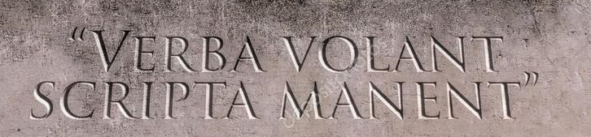
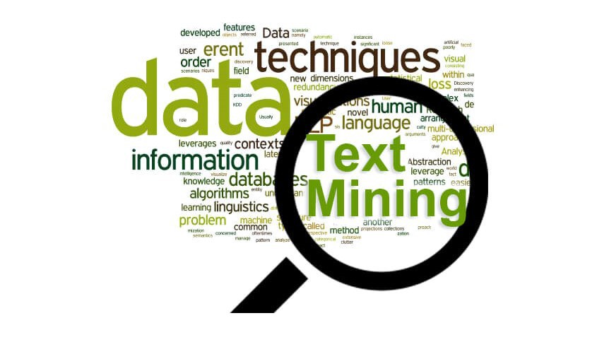

### La escritura

La escritura posiblemente sea uno de los mayores inventos de la humanidad. Permite fijar la palabra e (indirectamente) las ideas sobre un soporte permanente. Esto evita, como dice el refrán, que a las palabras se las lleve el viento, al tiempo que posibilita un nuevo modo de difusión de las ideas (Hodgson and Knudsen 2010). Paradogicamente en la antiguedad el refrán romano *Verba volant scripta manent* (lo dicho vuela, lo escrita queda) se usaba con la intención de destacar lo rígido de lo escrito indicando la dificutad de este para adecuarse a los nuevos hechos (Borges 1980).



Los sabios que convivieron con el inicio de la escritura también pensaban algo similar en cuanto a la mayor flexibilidad de lo hablado frente a lo escrito para responder nuevas preguntas originadas en un debate (Platón 2002). Con el advenimiento de la ciencia esta característica de lo escrito adquiere un nuevo valor. Esto impacta tanto en términos de acceso como de la propia producción de conocimiento. En términos de acceso cualquier persona que supiera descifrar ese código (alfabeto) podría “dialogar” con alguien que vivió hace siglos. Esto último se facilitó mucho con el invento de la imprenta y más actualmente, de modo más crítico, con la difusión de internet. De forma derivada, lo anterior impacta en la propia producción del conocimiento científico al permitir la constrastación y replicabilidad por parte de científicos que no interactuan personalmente con el productor original de una idea.

En la actualidad tanto la cultural oral como la escrita subsisten y tienen múltiples relaciones. Existen aplicaciones de celular que uno les “habla” y traducen lo escuchado a texto (digital). Lo mismo sucede a la inversa. Existen aplicaciones en donde uno ingresa texto, digitalizado (aunque sea una imagen) y la aplicación lo “lee” en voz alta. Esto produce que dominios de la realidad donde antes dominaba casi exclusivamente un tipo de cultura ahora se entrecruzan.

Sea como sea, la escritura, en su origen, se parece a un código secreto que encripta los sonidos orales. Como ocurre con cualquier código secreto, descifrar la escritura requiere aprendizaje. Luego de mucho ejercicio la mayoría de los humanos se convierten en un lector (y quizá también escritor) competente…¿Pero que sucede con una computadora?

### Datos Estructurados y datos no estructurados

> *“Todas las familias felices se parecen pero cada familia infeliz lo es a su manera”*  
> *(Tolstoy 2002, pag. 13)*

Pareciera que las computadoras son buenas para realizar “computos” o “calculos” teniendo como insumo dígitos y sus combinaciones como números, cuentas, etc. Sin embargo existe la creencia que aquellas no son buenas para realizar tareas con símbolos no numericos como las letras y sus combinaciones como palabras, oraciones, etc.

¿Es verdad que la computadora procesa sólo números?¿Cómo es que procesa los números?¿Podrían procesar las palabras de un modo similar al que procesan los números?. Parcialmente si. Después de todo, los números con los que trabaja una computadora están compuestos por dígitos y las palabras están compuestos por letras y tanto los dígitos como las letras son caracteres. Para una computadora cualquier caracter es una sucesión de 0 y 1 que interpreta en su sistema numérico binario con el cual genera (1) o no (0) un impulso eléctrico.

En efecto, algunas ramas de la linguística, como la bibliometría o el análisis del discurso, y más ampliamente lo que en la actualidad se denomina procesamiento de lenguajes naturales serían impensadas sin la ayuda de una estrategia cuantitativa y esta última estrategia sería inoperante sin la utilización de las computadoras.

Por lo anterior, la limitación no parece ser de la computadora en sí, sino de:

**a.** de nuestra dificultad para explicitar el modo mediante el cual se interpreta, sintáctica y semánticamente, el lenguaje,  
**b.** la (relativa) dificultad por analizar datos no estructurados  
**c.** la (relativa) dificultad de construir datos estructurados sobre estos temas

En lo que sigue sólo se focalizará en algunas alternativas para mitigar la problemática **c**. El punto **a** es algo a resolver por las respectivas disciplinas que estudian el lenguaje. El punto **b** es algo que está mejorando gracias a la inteligencia artificial y la mayor amplitud del origen de las fuentes de textos digitalizados (por ejemplo redes sociales) en donde la gente suele usar reglas de uso que se encuentran algo más cercana al dominio de la oralidad y que eran difíciles o costosas de “desgrabar” en el pasado.

En el contexto de las **bases de datos** y **análisis de datos**, usualmente al texto (digitalizado de alguna manera) se lo suele denominar “dato no estucturado”. Esto, como lo suguiere el epígrafe de Tolstoi, es sólo una definición por la negativa dada la casi infinitas formas que puede contener un dato “no estructurado”… ¿Pero entonces qué es un dato estructurado?

Para el dominio del análisis de datos sobre sólo 1 conjunto de datos, el proceso anterior se puede explicitar del siguiente modo. Siguiendo la(s) ya clásica(s) noción(es) de:

* **Matriz de datos** (*data matrix*) (Galtung 1973) (usual en las ciencias sociales)
* **Conjunto de datos** (*dataset*) (Wickham 2014) (usual en la estadística)
* **Tabla** (*table*) (Codd 1990) (usual en las ciencias de la computación)

Diremos que las 3 definiciones respetan la (mínima) estructura tripartita del dato que implica que un dato es un valor de una variable de una observación. Complementariamente, en el lenguage de la estadística, expresaremos lo siguiente:

* Cada **conjunto de datos** es un rectángulo conformado por conjuntos de observaciones (en las filas) y variables (en las columnas) y valores (en la intersección de las filas y las columnas).
* Cada **observación** contiene todos los valores observados de la misma unidad de observación (personas, edificios, etc.) a través de las diferentes propiedades.
* Cada **variable** contiene todos los valores observados de la misma propiedad (altura, cantidad de aulas) a través de las diferentes unidades.

Muchas veces un análisis de datos se realiza sobre más de 1 conjunto de datos, por lo que lo anterior, si se lo quiere generalizar al dominio de las bases de datos, se lo debe complementar con otros principios que regulan la forma en que se deben relacionar los diferentes conjuntos de datos o tablas. Esto último se verá en otro momento y tiene más que ver con la ciencia de la computación.

### Analizando el programa de la materia

Un ejemplo con el que se mostrará alguna de las posibilidades que arriba se mencionaron será el análisis del propio programa de la materia. Quizá el docente haya hablado sobre él en clases anteriores y/o posiblemente algunos de ustedes lo leyeron. En cualquier caso parece un texto apropiado para trabajar.

En un primer momento vamos a interesarnos por las palabras más que por las letras, las oraciones o un corpus entero. Teniendo en mente este objetivo una de las primeras cosas que hacemos en transformar el archivo original del programa (sea este un word, un pdf, etc.) en un simple archivo de [texto plano](https://es.wikipedia.org/wiki/Archivo_de_texto).

De esta manera tenemos un archivo que puede ser “leído” tanto por humanos como casi cualquier computadora. En este [link](https://raw.githubusercontent.com/diegoteca/public_files/master/programa.txt) se puede ver el programa de la materia en un formato de texto plano.

Una vez que tenemos el archivo en texto plano y online lo podemos ir a buscar con algún programa. En este caso los análisis se realizaron con el [programa R](https://www.r-project.org/).

En este caso específico, como nos va a interesar hacer análisis por palabras, se dice que las palabras van a hacer nuestra **unidad de análisis o de observación**. En este sentido, ni las letras, ni las oraciones, ni los diferentes elementos de un corpus van a hacer nuestra unidad de análisis, por lo que debemos poder identificar en el archivo original a las diferentes palabras. Obviamente en nuestro conjunto de datos cada una de las palabras deberían ir en las filas.

```
#Se va a buscar el archivo de texto plano

programa_txt_url<- "https://raw.githubusercontent.com/diegoteca/public_files/master/programa.txt"
```

```
#Se lee y se guarda esa lectura. Se usa en codificacion UTF-8

programa_txt<- readLines(programa_txt_url, encoding = "UTF-8")
```

```
#Se comienza el proceso de estructuración. Primero el texto original se estructura como "data frame" y luego como "tibble". #Ambos son ejemplos de "tablas"

programa_df <- data_frame (text=programa_txt)

programa_tb <- as_tibble(programa_df)
```

Una vez que el programa tiene en memoria al archivo hacemos un proceso de “tokenización” que consiste precisamente en diseccionar el archivo original en diferentes “tokens”. En este caso, a tono con nuestros objetivos, cada uno de los (diferentes) “tokens” son cada una de las (diferentes) palabras.

Si bien lo anterior es un (gran) primer paso todavía falta mucho para que lo anterior nos aporte algo significativo. Si recordamos que nuestra unidad de análisis son las palabras podríamos:

1. Adoptar el supuesto que cada vez que se utiliza la misma palabra se trata de la misma unidad de observación.
2. Pensar en alguna propiedad sobre la cual se podría informar algo de cada palabra. Un ejemplo podría ser la cantidad de veces que se utiliza cada una a lo largo del texto.
3. Pensar en una serie de palabras que, dado lo aceptado en los puntos 1 y 2, se usen como razonables excepciones. Un ejemplo serían los conectores como “porque”, “además”, etc.“.
4. Suponer que algunas palabras estrictamente diferentes deberían juntarse dado que se considera que la diferencia es escesivamente circusntancial. Por ejemplo, “abogado” y “abogados” o “abogado” y “abogada”.

De este modo, tendríamos un conjunto de datos no sólo estructurado, sino algo más limpio sobre el cual, posteriormente, se realizarán diferentes análisis.

La tabla 2, por más simple que parezca, ya contiene todos los ingredientes de una matriz de datos ya que en cada fila aparece una “unidad de observación” (una palabra) y se agregó una columna como “variable” que contiene el valor de una propiedad que caracteriza a cada palabra como la cantidad de veces que aparece esa palabra en el texto.

Por otro lado vemos que la cantidad de **unidades de observación** bajó notoriamente. Casi a la mitad. Esto sucede porque antes una palabra aparecía por cada vez que se repetía y ahora suma una vez sola por que se considera como el mismo “caso” (punto 1). A lo anterior se suma que se han extraído una serie de palabras “pegamento” como artículos, conectores, etc. (punto 3) al tiempo que palabras muy similares que antes eran diferentes unidades de observación ahora se unieron y sumaron sus cantidades (punto 4).

Llegados a este punto estamos en condiciones de realizar nuestro primer gráfico teniendo como insumo los datos de la tabla 2.

Finalmente, con los mismos insumos, realizamos una nube de palabras que intenta sintetizar la temática del programa de la materia 

# Referencias Bibliográficas

Borges, Jorge Luis. 1980. “El Libro.” In *Borges Oral*. Barcelona: Bruguera.

Codd, Edgar. 1990. *The Realtional Model for Database Management. Version 2*. Massachusetts: Addison Wesley.

Galtung, Johan. 1973. *Teoría Y Método de La Investigación Social*. Vol. I. II vols. Buenos Aires: Eudeba.

Hodgson, Geoffrey, and Thorbjørn Knudsen. 2010. *Darwin’s Conjecture. the Search for General Principles of Social and Economic Evolution*. Chicago; London: The University of Chicago Press.

Platón. 2002. *Phaedrus*. Translated by Robin Waterfield. Oxford World´s Classics. Oxford: Oxford University Press.

Tolstoy, Leo. 2002. *Anna Karenina*. Translated by Richard Pevar and Larissa Volokhonsky. London: Penguin books.

Wickham, Hadley. 2014. “Tidy Data.” *Journal of Statistical Software* VV (II).
