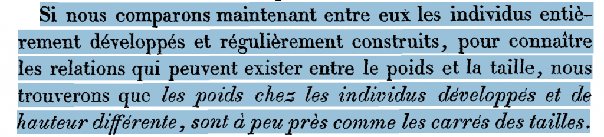
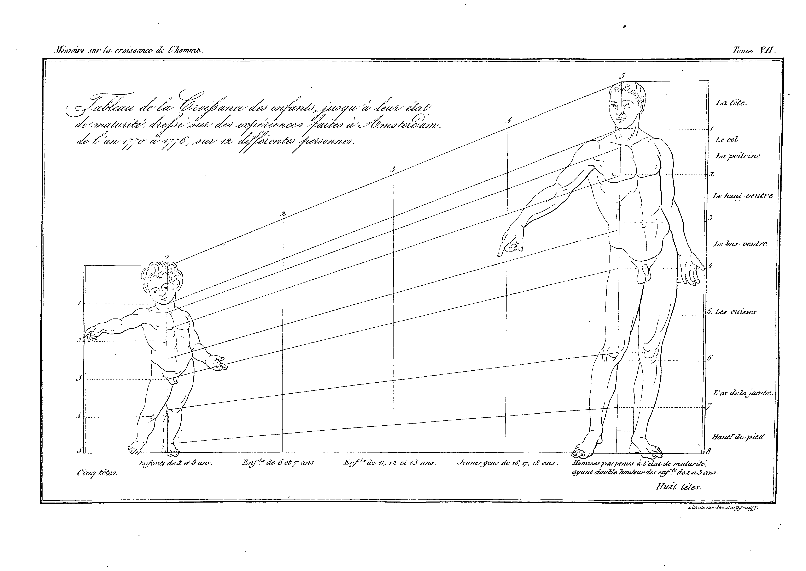
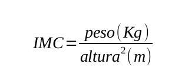

Tiempo de lectura:  14 minutos

Posiblemente desde los primeros tiempos de la humanidad, los humanos hayan distinguido, intuitivamente, que existen diferentes grados de «gordura» o «delgadez». En otras palabras, aquellos humanos, plausiblemente al igual que los actuales, pensaban que (cada uno de) los organismos de las personas tenían una propiedad que podía variar en **intensidad** o grado. Esta intuición fundamental es importante de remarcar porque es la puerta de entrada a un modo de conceptualizar la realidad. En efecto, siglos más tarde muchos pensaron que la intuición anterior se podía cuantificar, esto es, representar con un tipo especial de concepto como son las cantidades. Más específicamente como una magnitud. En este sentido, los griegos ya distinguían entre 2 tipos cualititavemente diferentes de cantidades: Las «multitudes» y las «magnitudes». Las primeras refieren a cantidades de propiedades discretas (p.e. «Paula tuvo 3 hijos» o «En la marcha hubo más de 250.000 personas» y su operación típica es el conteo. Las segundas refieren a cantidades de propiedades continuas y, generalmente, se las mide más que se las cuenta. Un vestigio actual de esa forma de pensar se pueden encontrar en la distinción del idioma inglés entre sustantivos contables e incontables.

Volviendo a la cuestión de la «gordura» muchos pensaron que esa cuantificación debía relacionar dos propiedades como  la «cantidad de espacio» y la «cantidad de materia» o, expresado de modo más específico, como una función que relacionara el «Volumen» y el «Peso» de las personas. Salvando las distancias, esto es similar en espíritu a una famosa historia que se detalla en el libro de arquitectura de [Vitruvio](https://es.wikipedia.org/wiki/Vitruvio) (80AC -15AC). Allí se comenta por primera vez la historia de [Arquímedes](https://es.wikipedia.org/wiki/Principio_de_Arqu%C3%ADmedes#Historia) y la corona de oro, o lo que visto desde la historia de la ciencia, podría decirse el germen del concepto de densidad de los objetos, esto es, un concepto que relaciona de manera explícita las magnitudes como el volumen y el peso de un mismo objeto. Por otro la historia también es un ejemplo de como con algo de ingenio se puede medir algo que, en principio, es incontable.

Como bien lo sabía Arquímedes, medir el volumen de un cuerpo irregular (como un organismo humano) es algo complejo. Si fuera regular se podría medir multiplicando el valor de la magnitud, en cada una de las siguientes tres dimensiones: la altura, el ancho y la profundidad. En parte por lo anterior, dado que la altura es la dimensión más importante del volumen de un humano (la altura siempre es mayor que el ancho y que la profundidad), quizá alguna relación entre altura y peso (más que entre volumen y peso) se pensó de manera intuitiva en muchas sociedades. Aquí, por razones de (im)pertinencia, sólo aclararemos que, para la física moderna, peso y masa son dos magnitudes diferentes con sus respectivas unidades de medida aunque aquí se tomarán como sinónimos.  En el cuestionario que se encuentra más abajo se dirá algo más al respecto.

Lo pertinencia de alguna relación entre «Altura» y «Peso» es que difícilmente, aún en sus intuitivos orígenes, se pueda considerar a la «gordura» como una función exclusiva de la «Altura» (ya que existe gente alta que difícilmente pueda clasificar de «gord@» o «delgad@») o como una función exclusiva del «Peso» (ya que existe gente que pesa poco y que sin embargo puede clasificarse como «gord@» o «delgad@).

Tómese nota que, con ciertas limitaciones, algunas de estas conceptualizaciones se pueden realizar en ausencia de lenguaje, del mismo modo como muchos niñ@s que todavía no entienden ni hablan (y menos leen y escriben) lenguaje verbal alguno son capaces de conceptualizaciones simples sobre números (por ejemplo la idea de conteo y ordinalidad). En general, podemos representarnos hechos para los cuales no tenemos (todavía) palabras y cuando sí las tenemos, cada sociedad puede usar, convencionalmente, palabras diferentes para representar los mismos hechos.

En este último sentido, las interpretaciones que cada sociedad (incluso para diferentes grupos de una misma sociedad) hizo/hace de la «gordura» o «delgadez» pueden variar con el tiempo. En efecto, para algun@s diferentes valores anteriores pueden ser considerado como una señal de:

a) Baja mortalidad neonatal (antes de los 28 días) y un indicador de alta probabilidad de que ese neonato de adulto tenga diabetes tipo II de adulto.

b) Fertilidad, fecundidad en el caso de las mujeres.

c) Capacidad de almacenamiento para épocas difíciles relativamentes prolongadas o, en el caso de las mujeres, baja tasa de mortalidad en época de lactancia.

d) Obesidad y su potencial relación con múltiples factores de mortalidad.

e) Indicador de una mala nutrición.

Más allá de las múltiples interpretaciones (positivas o negativas), tuvo que pasar un tiempo para alguien propusiera, para el caso de los humanos, alguna relación empírica específica entra la altura y el peso. Ese intento no tuvo, al parecer, una intensión de ofrecer una definición de «gordura» o «delgadez» pero sí allanó el camino. Este hito histórico puede rastrearse su origen escrito en un artículo de [Adolphe Quetelet](https://es.wikipedia.org/wiki/Adolphe_Quetelet) (1796-1874) denominado «[El peso del hombre en edades diferentes» (1832)](https://drive.google.com/file/d/1xktW4d0NyXBYeEABvsCgIhA3_HU6TxD7/view?usp=sharing). En ese artículo Quetelet, luego de analizar una vasta cantidad de datos tanto de adultos como de niñ@s, realiza en la página 28 la siguiente afirmación para el dominio de los adultos (ver la traducción de la cita siguiente desde el francés al español [acá](https://translate.google.com/?hl=es#fr/es/LE%20POIDS%20DE%20L'HOMME%20AUX%20DIFF%C3%89RENS%20AGES%20(1832)%20%0A%0ASi%20nous%20comparons%20maintenant%20entre%20eux%20les%20individus%20enti%C3%A8-%0Arement%20d%C3%A9velopp%C3%A9s%20et%20r%C3%A9guli%C3%A8rement%20construits%2C%20pour%20conna%C3%AEtre%0Ales%20relations%20qui%20peuvent%20exister%20entre%20le%20poids%20et%20la%20taille%2C%20nous%0Atrouverons%20que%20les%20poids%20chez%20les%20individus%20d%C3%A9velopp%C3%A9s%20et%20de%0Ahauteur%20diff%C3%A9rente%2C%20sont%20a%20peu%20pr%C3%A9s%20comme%20les%20carr%C3%A9s%20des%20tailles.%0A(pag%2C%2028))):

Lo importante del artículo es que Quetelet, propone una relación funcional, especialmente para el dominio de los adultos, en donde la gente usualmente crece de peso en función del cuadrado de su altura. En efecto, el piensa que si el hombre creciera igualmente en las tres dimensiones, el peso debería ser función cúbica de la estatura (o el ancho, o la profundidad). En este sentido, lo que Quetelet afirma puede considerarse como una [proposición](https://es.wikipedia.org/wiki/Proposici%C3%B3n), esto es:

* Una oración expresada en algún lenguaje (en este caso el francés),
* Con un significado más o menos claro (que afirme algo sobre algo) y que
* (quizás) mediante alguna operación empírica se le pueda asignar un valor de verdad como verdadero (o falso) en algún grado.

Si una oración no tiene un significado claro no hay operaciones empírica alguna que le pueda asignar un valor de verdad. La significación de una oración es condición necesaria para que una oración pueda considerarse una proposición pero no suficiente para que a una proposición se le puede determinar su valor de verdad. Por otro lado, como lo demuestra la traducción de arriba, una oración expresada en un lenguaje (algunas veces) puede traducirse a otro lenguaje. La ciencia se suele esforzar por construir lenguajes artificiales (algunos formales) que usualmente se basan en alguna *lingua franca* (hoy el inglés) para favorecer la comunicación y crítica.

Las proposiciones pueden considerarse (uno de) los ladrillos con los que se construyen teorías. En otras palabras, una [teoría](https://es.wikipedia.org/wiki/Teor%C3%ADa) puede considerarse como un sistema conceptual compuesto por proposiciones unidas por consecuencias lógicas. A veces las proposiciones son supuestos, otras veces son hipótesis.

Si se acepta lo anterior, la oración de Quetelet, si se la quiere considerar como una proposición se debe aclarar su significado y para eso necesitamos separar la paja del trigo, esto es, debemos distinguir las proposiciones de los conceptos con que ellas fueron construidas. Así como las proposiciones pueden considerarse como (uno de) los ladrillos de las teorías, los [conceptos](https://es.wikipedia.org/wiki/Concepto) pueden considerarse como (uno de) los ladrillos de las proposiciones. En el discurso científico todo concepto clave se debe dilucidar, esto es, aclarar su significado. Esto último es lo que Quetelet no hace (en parte porque no era su objetivo), pero sin embargo, como veremos más adelante es posible hacer con lo que dice.

## Visiones más contemporáneas

Luego del trabajo de Quetelet se desarrollan una serie de índices que, teniendo como insumo el peso y la altura, tuvieron como objetivo captar distintos aspectos relacionados con la salud. Un ejemplo simple (pero útil en tiempos de escaso alfabetismo, libros y computadoras) es el índice de Broca (1871) que para calcular el peso ideal resta 100 al valor de la altura en centímetros y luego le resta otro 10% a los hombres y un 15% a las mujeres.

Otro ejemplo interesante se dio en el campo de la pediatría donde se utilizó un índice denominado «Pedilisi» con el objetivo de detectar problemas de nutrición, especialmente de raquitismo. El mismo fue inventado por Clemens von Pirquet en contextos de la primera guerra mundial. Por estas latitudes, el pediatra argentino Juan Pedro Garraham fue un activo difusor de este índice en la década del 20.[¹](/media/metodocuanti/El-indice-de-von-Pirquet-para-lña-determinación-del-estado-nutritivo-Garraham-P.-1922.pdf)

Von Pirquet pensaba que dado que a lo largo de la infancia y la adolescencia va cambiando la relación entre la altura de las piernas y la longitud total (el denominado índice de Cormic) a nuestro amigo von se le ocurrió que se podía relacionar el peso con la altura pero con una importante diferencia: La altura se mediría sentado, controlando de ese modo la influencia de la creciente altura de las piernas en las diferentes edades. En efecto, su indice proponía primero multiplicar por 10 el peso, luego aplicarle la raíz cúbica y, posteriormente, dividir el resultado anterior por la altura sentada (desde la cola hasta la punta de la cabeza).

La base del índice de Cormic es la diferente proporción de la altura de las piernas en infantes y adultos. En la imagen se observa que en el infante las piernas ocupan 2/5 de la altura total y en los adultos esa relación  pasa a 4/8. Imagen tomada de Quetelet 1832.

Casi 150 años después de lo escrito por Quetelet, un fisiólogo llamado [Ancel Keys](https://es.wikipedia.org/wiki/Ancel_Keys), recupera el trabajo seminal de Quetelet y introduce el concepto de Indice de masa corporal (*Body Mass Index*) en un artículo denominado [«Indices de pesos relativos y obesidad» (1972)](https://drive.google.com/file/d/1JJPkMOkL-HX5tedpztkry7Fkx1eyp5Cz/view?usp=sharing). Teniendo presente el párrafo arriba descripto hace el esfuerzo por traducir las palabras de Quetelet a un tipo de lenguaje específico que no es ni el francés, ni el español ni el inglés. En efecto, lo traduce a un lenguaje formal, proponiendo la siguiente definición del nuevo concepto:

en donde se expresa que el (valor del) IMC es directamente proporcional al valor del peso (expresados en Kilogramos) e inversamente proporcional al cuadrado del valor de la altura (expresados en metros). En otras palabras, lo que realiza Keys y su gente es proponer:

a) un nuevo concepto al cual se lo designa con el nombre de índice de masa corporal (IMC o *BMI* en inglés) y,

b) una relación específica **entre** las variables que hablaba Quetelet que se propone es, **idéntica por definición**, al nuevo término linguístico introducido en a)

Cabe aclarar que los conceptos no se pueden someter a las pruebas empíricas que sí pueden someterse a (algunas de) las proposiciones. En efecto, los conceptos usualmente no niegan ni afirman nada, y no «proponen» (casi) nada sobre el mundo. Por lo tanto no existen conceptos falsos o verdaderos: los conceptos sólo pueden ser exactos o vagos; aplicables o inaplicables; fructíferos o estériles;  estar más o menos difundidos en una disciplina. Lo que sí puede tener valor de verdad son (algunas de) las diferentes proposiciones que se pueden construir con ellos. Por ejemplo, en la publicación arriba mencionada, a Keys, con un tono marcadamente metodológico, le interesa indagar algunas relaciones entre cada uno de los (valores de los) conceptos disponibles y determinados características de los organismos que se acercaban progresivamente al *Gold Standard* de la obesidad. Los candidatos conceptuales eran 3:

a) el IMC o Masa/Altura²,

b) el más simple Masa/Altura;

c) y el índice de Rohrer o Masa/Altura³.

Como primera medida le interesaba cual de ellos sería, en distintas poblaciones, más independiente de la altura (Keys et. al., 1972, pp. 336). Esto último implica, con cada uno de los conceptos seleccionados, la construcción de respectivas proposiciones y sus respectivos grados de verdad luego de una investigación empírica. El estudio llega a la conclusión que el IMC, no sin dificultades, es el índice que menos correlaciona con la altura, al tiempo que es el que más correlaciona con la grasa subcutánea (medida por el espesor de los pliegues cutáneos) y la densidad del organismo (medida por sumersión en agua como aprendimos de nuestro viejo amigo Arquímedes). Esta última propiedad es considerada como el *gold standard* y se postula, luego de una investigación empírica con un claro fin metodológico en donde el *gold standard* forma parte de la base empírica, que tal o cual concepto es un mejor (o peor) indicador que otro. En otras palabras, se asume, basado en la evidencia que el IMC es un buen indicador observable de algo relativamente más inobservable.

Más allá de las deficiencias de la propuesta original de Quetelet y la formalización posterior de Keys, la misma nos interesa desde el punto metodológico porque muestra como, con origen en una proposición construida en un lenguaje no formal, se dilucida un concepto a través de una definición explícita y formal. En efecto, utilizando el esqueleto formal de una ecuación se formaliza un razonamiento anteriormente más vago afirmando que lo que se encuentra a la izquierda del signo «=» es, como se suele afirmar en epistemología, «idéntico por definición» a lo que se encuentra a la derecha del mismo.

Así como en las ecuaciones se habla del miembro que se encuentra a la izquierda (primer miembro) o la derecha (segundo miembro) del signo igual, en epistemología se dice que los conceptos que se definen, esto es, aquellos (nuevos) términos que se introducen, son el *definiendum* mientras que los términos utilizados para su definición (con un significado ya conocido) constituyen el *definiens*. El término linguístico (nombre) utilizado para designar el concepto es, en principio, totalmente convencional, aunque, claro está, es razonable suponer que en cada época habrá algunos candidatos más idóneos que otros.

En cuanto a la relación en la definición propuesta desde un costado metodológico puede interpretarse, formalmente, como una función. Estos es, dados unos valores específicos de peso y altura, se puede calcular un (y sólo un) valor específico valor de IMC. Recordar que, en términos matemáticos, toda función es una ecuación pero no toda ecuación es una función y que una función relaciona de un modo preciso una serie de inputs o entradas (en este caso el par ordenado del peso y la altura) con exactamente un ( y sólo un) output o resultado. Obviamente lo anterior no impide que distintas configuraciones de peso y altura tengan un mismo valor de IMC. Por ejemplo, una persona de 60 Kilos y 1,6 Metros de altura tiene un IMC de +- 23,4, el mismo (aproximado) valor de una persona que pesa 100 Kilos y mide 2,06 Metros. Estas características son muy importantes a la hora de la contrastación de las proposiciones que se pueden construir con el concepto de IMC.

Otro aspecto formal que se puede analizar es su aspecto algebraico. En este sentido, la relación que se encuentra a la derecha del signo «=» se podría utilizar en otras fórmulas. Se podría imaginar (dejando de lado su grado de verdad) que la cantidad de (e)migraciones de una ciudad de origen hacia otra de destino es directamente proporcional al tamaño de la ciudad (nuestra anterior «masa») de destino e inversamente proporcional al cuadrado de su distancia (nuestra anterior altura). Una diferencia entre este ejemplo y el índice de masa corporal es que el primero es una proposición (como por ejemplo una hipótesis o un supuesto) y el segundo una definición de un concepto. Por esta razón el primero se puede contrastar y el segundo no.

EL IMC puede considerarse un ejemplo de un concepto que, dado su:

a) relativa facilidad de construcción en términos de operaciones empíricas no invasivas y económicas, sea tanto a través de mediciones reales (balanzas, centímetros, etc.) o con preguntas que refieran a ellas,

b) su corroborada relación con algún «gold standard» y,

c) su corroborada relación con otros estados o procesos,

se convierta en un plausible candidato a ser utilizado como un indicador de muchas investigaciones, aun de investigaciones con marcos teóricos bastantes diferentes. En función de esto, en los párrafos que siguen se analizará:

a) la diferencia de aplicar los resultados a individuos o a poblaciones,

b) la propuesta de utilizar el IMC para estudios de cribado o «screening» clínico

A pesar de resultar de operaciones empíricas sobre individuos, análisis agregados sobre su distribución (por ejemplo su media) suelen aportar informaciones sobre poblaciones. Estos datos son importantes para investigaciones demográficas, epidemiológicas, actuariales, para la toma decisiones políticas así como la evaluación de diferentes políticas públicas. De manera algo contraintuitiva, estos indicadores pueden servir a nivel poblacional aun cuando tengan conocidos errores a nivel individual, lo que los hace algo menos útiles en la clínica individual.

Es sabido que a nivel individual el IMC tiene algunos problemas. Por ejemplo, supone que todas las personas tienen una densidad media. Este supuesto es falso porque como los demuestran distintas observaciones (vía una densitometría) existen personas con huesos más (menos) densos que la media. Otro ejemplo surge de muchos atletas, que pueden tener un mayor porcentaje de musculatura lo que también falsea el supuesto anterior ya que el músculo es más denso que la grasa.

También se sabe que el índice, no tanto por las medidas involucradas (masa y altura), sino por la función específica que relaciona los valores de las mediciones, tiene algunos sesgos en los extremos de las alturas. Específicamente, en las personas de baja estatura el índice aumenta los falsos negativos (baja la especificidad) y con los de mayor altura aumentan los falsos positivos (baja la sensibilidad).

Los dos conocidos errores de medición anteriores nos sirven para marcar un punto importante. Si ambas características (la densidad y la altura) se distribuyen normalmente en una población, los comentarios de los últimos párrafos impactan de forma diferente para alguien que trabaja principalmente de forma clínica (por ejemplo la clínica individual de una nutricionista) o para alguien interesado en averiguar los efectos de una suba del precio de las bebidas azucaradas en el grado de obesidad de una población.

Suponiendo que efectivamente la altura y (en menor medida) la masa de las personas, al menos en diferentes edades, se distribuye aproximadamente en formal normal ([Eveleth & Tanner, 1991](https://drive.google.com/file/d/15JEiBXYGeC6XsoyOILXA-G1Zjw3AmyKJ/view?usp=sharing)) la media de las medias de muchas muestras no muy pequeña de casos, siempre que no se tengan sesgos muestrales, convergerá a la media de la población con un margen de error conocido. Cuanto mayor sea el número de casos de la muestra, menor será el margen de ese error, por lo que, de forma algo contraintuitiva, un indicador con conocidos errores de

## Conclusion

El largo recorrido realizado por este concepto desde su plausible ideación concreta (aunque vaga) en la cabeza de muchos de los primeros homo sapiens, hasta la ideación acerca de la relación entre peso y estatura, pasando por la relación más precisa propuesta Quetelet, la introducción del concepto explícitio de IMC, la especificación del mismo a diferentes poblaciones.

[table id=1 /]

Ir a las [Preguntas](https://docs.google.com/document/d/1BU59OHYcTvV6TUVJNWPfbJCY_WyMSvGqODG4W7kHF8o/edit?usp=sharing):

Ir a la [Encuesta](https://diegoteca.com.ar/encuestas/index.php/699336?lang=es).
