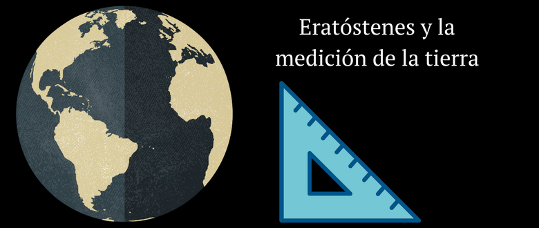
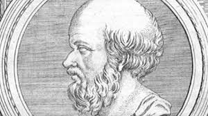

Tiempo de lectura:  3 minutos

Sin **operaciones empíricas** como observar y experimentar no se pueden producir **datos** y sin estos difícilmente la ciencia llegue muy lejos. La razón es que:

a) De modo más estático, los datos son necesarios para contrastar hipótesis y, de modo derivado, las teorías que se implican en ellas.

b) De modo más dinámico, los datos pueden ser útiles a la hora de generar nuevas hipótesis, en parte sugiriendo, gracias al punto «a», en donde fallan las ya disponibles.

En términos amplios puede decirse que los datos son los ladrillos empíricos a través de los cuales se va a intentar contestar la «pregunta» de investigación. Estos se **producen** a través de operaciones empíricas. Luego, en la fase de **análisis**, se realizan una serie de **operaciones conceptuales** con esos ladrillos (por ejemplo un promedio o un porcentaje) y, a la luz de alguna teoría que ayude a interpretarlos, se **construye** la **evidencia**. Esta es la que finalmente permite contestar la «pregunta» de investigación.

La realización de operaciones empíricas permite que el investigador interactúe con un dominio restringido de la realidad produciendo datos de esta, esto es, averiguando valores específicos para las propiedades (de cada una) de sus unidades de observación. Un punto importante a destacar es que en ese camino el resultado obtenido de esas operaciones difiera del valor «real» de la propiedad en cuestión. En ese caso se dice que existe un error en la operación empírica. Como existen muchas clases de operaciones empíricas también existen muchas clases de errores como los errores de observación, de medición, etc.

No sólo eso. Al igual que la relación entre datos (ladrillos) y evidencia (la construcción que se hace con esos ladrillos), en los tipos de errores también pueden distinguirse varios niveles. Si se prefiere, puede decirse que existen errores empíricos básicos en los datos y errores conceptuales en los análisis y/o interpretación de los mismos. En efecto, ademas de los errores sobre cada una de las propiedades de cada una de las unidades de observación, existen errores de cálculo (un mal promedio), errores de muestreo (una mala muestra), que, aún en el caso en que no existan errores en los datos empíricos básicos, invalidan la «respuesta» a la pregunta de investigación por un error en la propio construcción de la evidencia.

A continuación se presenta un pequeño video en donde se muestra una famosa investigación realizada por Eratóstenes hace más de 2000 años. [Eratóstenes](https://es.wikipedia.org/wiki/Erat%C3%B3stenes) (276 ac -194 ac) fue un polímota, esto es, una persona cuyos conocimientos abarca diferentes campos de estudio. Inventó el propio término de geografía (*geographika*) y fue el autor de la primera obra sistemática sobre el tema. Además fue director de la biblioteca de Alejandría en la época Tolomeica.

Más allá de la ingeniosa experiencia realizada por Eratóstenes, que obviamente temáticamente no tiene mucho que ver las ciencias sociales, lo interesante es poder utilizar los conceptos vistos en la materia para identificar y clasificar las diferentes operaciones conceptuales y empíricas que él realiza.

la ingeniosa manera que tuvo Eratóstenes para medir la circunferencia de la Tierra, hace más de 2000 años. Lo interesante de esta experiencia es que Eratóstenes, que manejaba teorías relativamente avanzadas para su época, tuvo que ingeniar indicadores y posteriormente la realización de diversas operaciones empíricas para luego realizar cálculos sobre ellas para realizar estimaciones e interpretar los resultados (a la luz de la/s teoría/s que se encontraban por detrás de sus indicadores).

Advertencia. Los instrumentos de medición de Eratóstenes fueron principalmente unos palos y sus respectivas sombras.

[Video sobre la estimación de la circunsferencia de la tierra por Eratóstenes ](https://drive.google.com/file/d/0B2chaN7IisSTUmJWZHZ6WE5lU3c/view?usp=sharing)

[Guía de preguntas sobre el video](https://docs.google.com/document/d/1LcoIkpyAxs3U1yDajINlHPxJEBNQ4g-NvOkR-MGF4Kc/edit?usp=sharing) 