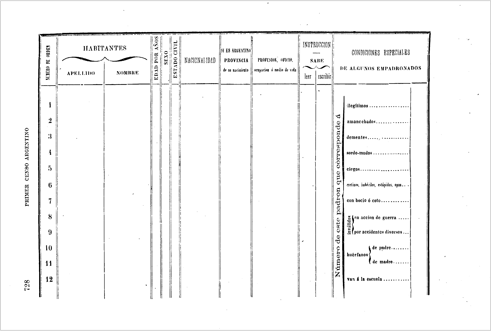
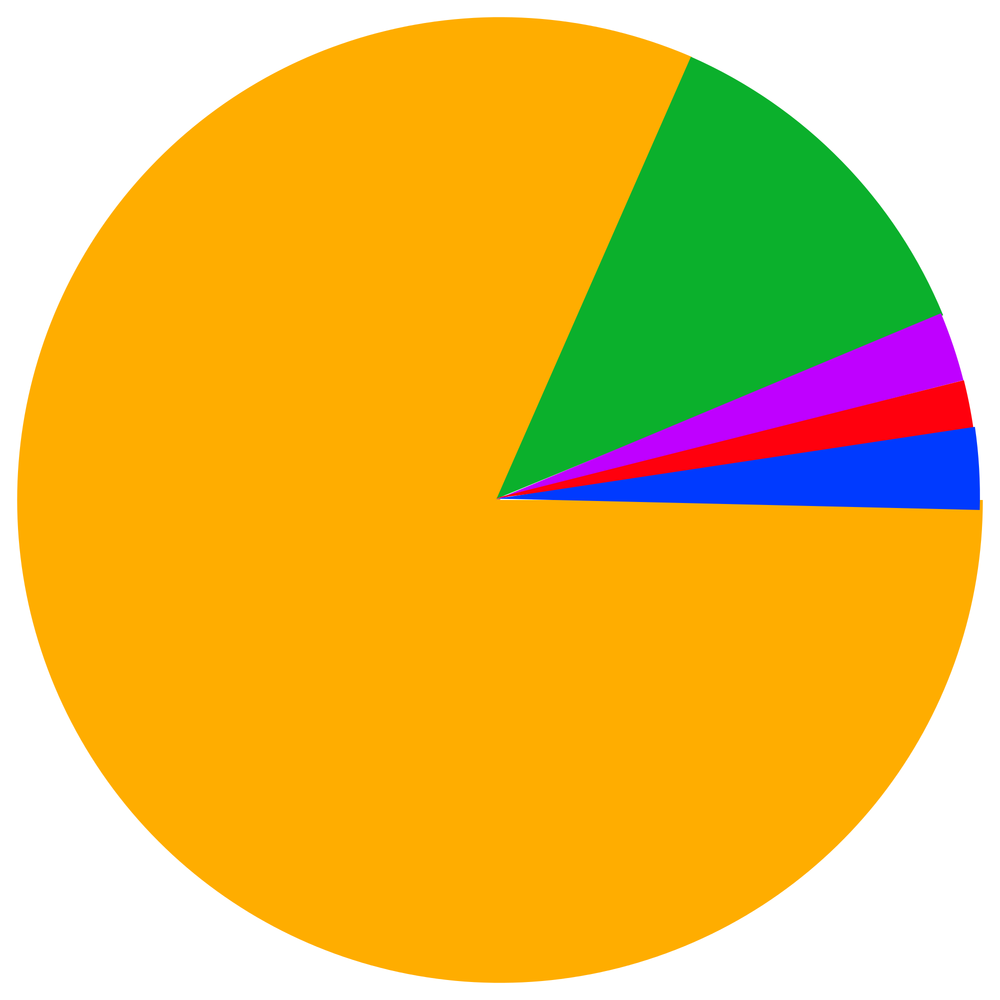

Tiempo de lectura:  4 minutos

## Cuestionarios, formularios y entrevistas

El **cuestionario** (*questionary*) es un modo clásico de captar datos de la realidad que vas más allá de las ciencias sociales. En efecto, como su nombre lo siguiere, tanto en español como en inglés, «cuestionario» deviene de la palabra latina «*quaestionarius*» que a su turno es una conjunción de la palabra «**cuestión**» (*question*) y del sufijo «**ario**» *(ary)* que suele significar «relacionado con»*.* Sea como fuera, los cuestionarios implican una **serie de preguntas** ya previamente **formateadas** tanto en su orden como forma de redacción.

En efecto, el término lingüístico **formulario** (*formulary*), con creciente uso en las últimas décadas asociado al mundo digital, es una expresión alternativa que aquí se las considerará con un significado similar. La razón es que al igual que cuestionario su significado deviene de la unión de una raíz latina como «**formula**» más el sufijo «**ario**» (*ary*), por lo que su etimología sugiere que su significado tiene que ver con lo relacionado con la forma, ya que formula es un diminutivo de la palabra latina **forma**.

Cuestionario utilizado en el primer censo nacional de población (1869)

Las **entrevistas** (*interviews*), como también su nombre lo siguiere, originalmente implicaban una relación cara a cara (o más bien ojo ? a ojo ?). El auge de la tecnología hizo poner en tensión el significado del término como cuando un periodista afirma «tenemos una entrevista (telefónica y no cara a cara) con ….». De todos modos, parece haber consenso en que las entrevistas pueden considerarse como una relación en donde existen personas que preguntan y personas que responden. Esto es una diferencia crucial con el término cuestionario el cual nunca parece haberse asociado, de modo necesario, a una relación entre personas ni menos todavía a una relación cara a cara . Otra diferencia importante es que las entrevistas no asumen el **formateado** de los cuestionarios tanto en el orden como en la formulación de la pregunta.

El formateado de un cuestionario suele exigir, por definición, misma forma en la **pregunta**, no necesariamente en la **respuesta**. El mismo formateo facilita, desde un punto de vista **metodológico**, la **comparabilidad entre las respuestas** porque hay un esfuerzo explícito por igualar el estímulo que produce la pregunta. La respuesta a ese estímulo, en cambio puede ser, como se suele afirmar, abierta o cerrada, aunque usualmente los cuestionarios se diseñen con mayoría de respuestas cerradas. Esto último facilita, desde un punto de vista **técnico**, la presentención de las mismas como un **dato estructurado** y el posterior el **análisis** de las mismas mediante diferentes técnicas, usualmente estadísticas. Cabe aclarar que el mismo formato de pregunta, en algunas situaciones, pone fuertes trabas a la recolección (no respuesta) y/o validez (mentira) del dato, como por ejemplo, en investigaciones en donde se intenta averiguar el significado o las razones de comportamientos ilegales, estigmatizados, etc.

El auge de las tecnologías digitales y la propia difusión de internet han permitido que los formularios digitales tengan una cantidad de beneficios frente a un cuestionario en papel que décadas atrás parecían imposibles. Algunos de ellos son los siguientes:

* Nuevas posibilidades en los modos de preguntar que difícilmente tengan contraparte en un cuestionario en papel.
* Posibilidad de chequeos de consistencia en el mismo momento en que se produce el dato.
* Reducción de costos logísticos para localizar determinados casos como aquellos a) lejanos geográficamente o b) escasos en términos sociales pero ubicables en términos de redes sociales/mail. .
* Fusión del proceso de recolección/producción del dato con el de carga del mismo.
* Base de datos en un solo archivo online.
* Posibilidad de análisis automatizados desde el mismo archivo online.

Algunas veces los formularios online sólo se usan como un modo de cargar en un sólo archivo de forma descentralizada los datos que se produjeron en campo o en el laboratorio. Otras veces, se sale a campo (o se entra al laboratorio) con el mismo formulario digital (sea en modo offline o online) o bien se puede contactar a los respondentes directamente en forma digital (vía redes sociales /mail).

En la siguiente actividad se contestará un simple (muy simple!) cuestionario online hecho con la aplicación gratuita de [Google Forms](https://www.google.com/intl/es-419_ar/forms/about/).

[Ir al formulario](https://goo.gl/forms/WLoNeRwkOO1iEo5L2)

[Ir a análisis univariados del formulario](https://docs.google.com/forms/d/e/1FAIpQLScSQeDoycgo_q56U2lGBYBTrlFiIzBBZFyltQoqVQlNc_pdKg/viewanalytics)

[Ir a la matriz de datos del formulario](https://docs.google.com/spreadsheets/d/1tGhcWoGQhMO7UAeWpPX9eQ8djldqGsVsfe0iQQKuUfE/edit?usp=sharing) 

[Ir a video de como se puede hacer un formulario de Google (El video es de sólo 2 minutos!)](https://www.youtube.com/watch?v=LMFoajXjwkA) 