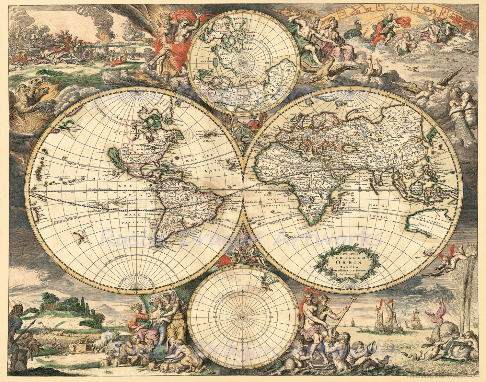
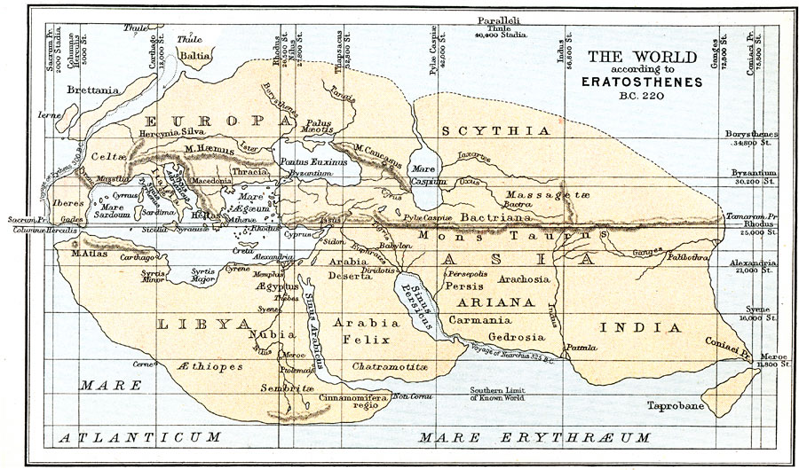
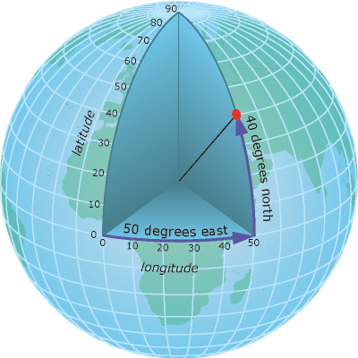
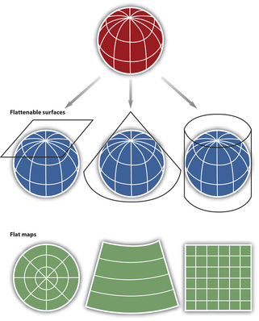
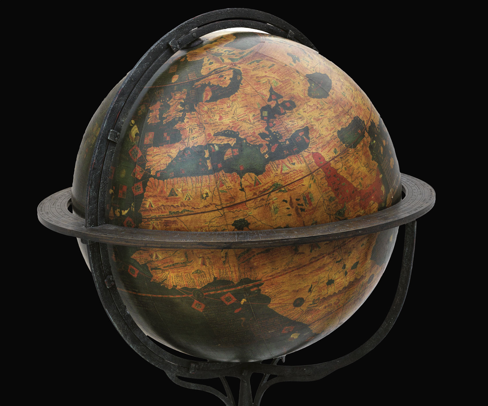
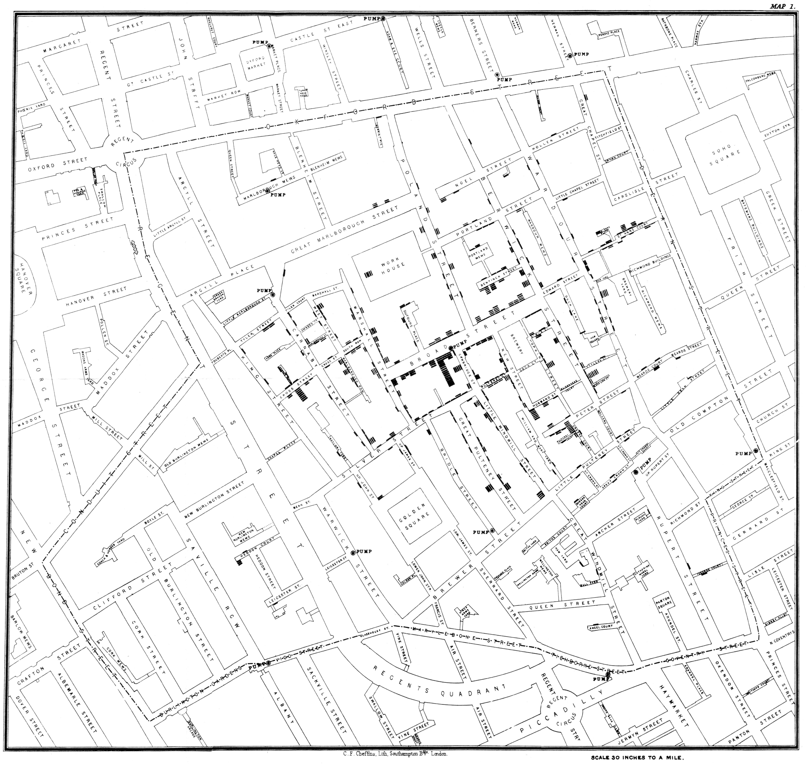

Tiempo de lectura:  6 minutos

Los mapas, en general, son una representación gráfica, usualmente sobre un plano, que hace visible relaciones entre elementos en algún espacio. Los mapas geográficos (o cartográficos), en particular, suponen unas propiedades métricas que dependen de la proyección utilizada, y posibilitan la toma de medidas de distancias, ángulos o superficies sobre él y su posterior proyección a la realidad. En la antigüedad, cuando sólo se sabía la ubicación específica de pocos elementos (no había GPS), se confiaba en la representación gráfica realizada sobre un plano (mapa) construido sobre esas (pocas) ubicaciones conocidas y se calculaba la posición de los elementos todavía no posicionados, sea tanto una nueva ciudad conocida o la propia ubicación de un viajante.

Mapa realizado por Eratóstenes alrededor del 220 AC.

En la actualidad, gracias a la tecnología satelital, se puede tener información de la ubicación específica de (casi) todo lo que a uno le interese. De todos modos, la parte conceptual que se encuentra por detrás de lo anterior es sumamente antigua. En efecto, su creador fue nuestro viejo amigo [Eratóstenes](/content/metodocuanti/post_la-medicion-de-la-tierra-por-eratostenes.html). Él ideó lo que se considera el primer sistema de coordenadas geográfica en donde, bajo el supuesto de la esferidad perfecta (un cuerpo), con sólo 2 datos se podría determinar cualquier posición.

Sistemas de coordenadas teniendo como referencia una esfera o algún tipo de elipsoide.

De modo conceptualmente independiente, para localizar esa posición en un mapa de 2 dimensiones (plano) se requiere una proyección, esto es, una relación ordenada entre los puntos de la superficie curva de la Tierra, (o en general de cualquier cuerpo) y los de un mapa, (o en general de cualquier plano).

Proyecciones genéricas. La 3ra es la más similar a la usual proyección de Mercator

Es este sentido, es importante aclarar que todo mapa geográfico de 2 dimensiones implica alguna proyección y que, dependiendo cual sea está última, genera un tipo de distorsión específica. La distorsión se genera al pasar de un mundo con 3 dimensiones (cuerpo geométrico) a un plano con 2 dimensiones (figura geométrica). Por ejemplo la [proyección Mercator](https://es.wikipedia.org/wiki/Proyecci%C3%B3n_de_Mercator), la usual cuando un@ va (¿o iba?) a una librería a comprar un mapa n° 3, supone que Groenlandia aparece aproximadamente del tamaño de África, cuando en realidad el área de África es aproximadamente 14 veces la de Groenlandia. Lo anterior no sucede en los globos terráqueos ya que estos no son proyecciones.

El *erdapfel* es el globo terráqueo más antiguo que aún se conserva. Lo construyó un cartógrafo alemán llamado Martin Behaim en 1492.

Aún con sus imperfecciones , los mapas planos también son de gran utilidad por fuera de la navegación. En efecto, pueden servir para hacer observables hechos que antes no lo eran, así como para el diseño, ejecución y evaluación de políticas territoriales. Por ejemplo, [John Snow](https://es.wikipedia.org/wiki/John_Snow), uno de los fundadores de la epidemiología, logró trazar el origen del cólera siguiendo la pista de los enfermos a través de un mapa. Con esta ayuda hipotetizó que el agua en mal estado era un vector importante en la propagación de la enfermedad cuando por aquel entonces se suponía que el cólera (al igual que la peste bubónica) tenía que ver con la polución del aire más que con el agua.

Snow llegó a su conclusión luego de «georeferenciar» los fallecimientos (gracias a que un cura amigo averiguó donde vivía esa gente!) y observar la cercanía de la mayor cantidad de muertes con una bomba manual de agua pública. Recomendó retirar la manija de la bomba y a los pocos días la epidemia cesó. Posteriormente se supo que los desechos de uno de los pozos ciegos de las casas linderas se había filtrado hacia la capa freática que la bomba extraía el agua.

Mapa original de John Snow (1854). Los puntos negros simbolizan fallecimientos.

La georefeenciación es un proceso que consta en asignarle unas coordenadas geográficas específicas a algún hecho, aun cuando este cambie en tiempo y espacio, como por ejemplo, la trayectoria recorrida en una bicicleta. Todo lo que se pueda decir que sucede en un espacio geográfico es plausible de aplicarle una georeferenciación. La cantidad de información georeferenciada viene creciendo a pasos agigantados en los últimos tiempos. Esto es especialmente notoria en ciertos datos importantes que no cambian seguido en el tiempo, como por ejemplo, las divisiones políticas de los países. Este tipo de datos ya suelen ser de libre disponibilidad y son un soporte genérico para cualquier investigación específica.

El talón de Aquiles de una investigación que quiera hacer uso de los mapas modernos es que cada investigador debe agregar los datos específicos de su investigación que quiera georeferenciar. Expresado en la jerga actual, se dice que cada investigador debe agregar una *capa* específica que contenga sus datos para luego, si lo desea, relacionarla con los otros datos genéricos que se almacenan en otras capas genéricas. Para fijar las ideas, si yo quiero realizar una investigación con los estudiantes de la Universidad voy a tener que tener georeferenciada la ubicación de cada uno de ellos. Como sucede con cualquier observación o medición, cualquier dato preciso se puede agrupar después pero la inversa no es posible. Por ejemplo si tengo el municipio en donde vive cada estudiantes podré hacer un mapa que coloree los polígonos de los municipios en función de la cantidad de estudiantes ([*Colorpleth*](https://datavizcatalogue.com/ES/metodos/mapa_coropletico.html)) pero no podré hacer un [mapa de puntos](https://datavizcatalogue.com/ES/metodos/mapa_de_puntos.html), porque este requiere las coordenadas exactas donde vive cada estudiante. En cambio, si tengo las coordenadas puedo hacer tanto el mapa de puntos como una graficación de los polígonos de cada municipio.

La tecnología que permite manejar y dibujar un mapa trabajando con varias capas de información georeferenciada se llama GIS (Geographical Information System). Históricamente De forma más contemporánea, los GIS online, también permitieron que no sea (tan) necesario como antes la construcción de mapas sobre un plano mediante una única proyección. La razón es que en la actualidad, la conocida función de «zoom» de programas como google maps (o su antecesor el google earth) ajusta de modo automático entre diferentes proyecciones. En otras palabras, se actualiza una proyección diferente para cada nivel de zoom.

En otras palabras, los mapas online de ahora son la unión de:

* Una mejor información satelital en cuanto a fotos satelitales y cálculos de distancias.
* Una gran cantidad de información georeferenciada (capas), muchas (ahora) construidas por voluntarios desde sus teléfonos celulares
* Una mejor procesamiento digital de mayor información disponible, mediante programas GIS y (ahora) también web, que vuelve menos relevante la construcción de un mapa sobre un plano.

Actividad:

Vaya a [google maps](https://www.google.com/maps/place/Universidad+Nacional+Arturo+Jauretche/@-34.7771664,-58.2766177,14z/data=!4m5!3m4!1s0x0:0xbd0aa21eac3ef032!8m2!3d-34.775147!4d-58.267917) y dirígese a la dirección de la Universidad. Una vez allí, copie el link de la url y abra esa misma dirección en otra pestaña.  En la pestaña original, mantenga la visión tipo «mapa» y comience a alejarse con el zoom. Aléjese lo más que pueda y mire la atentamente la imagen. Ahora en la otra pestaña  ejercicio con vista satelital y mapa de google maps.