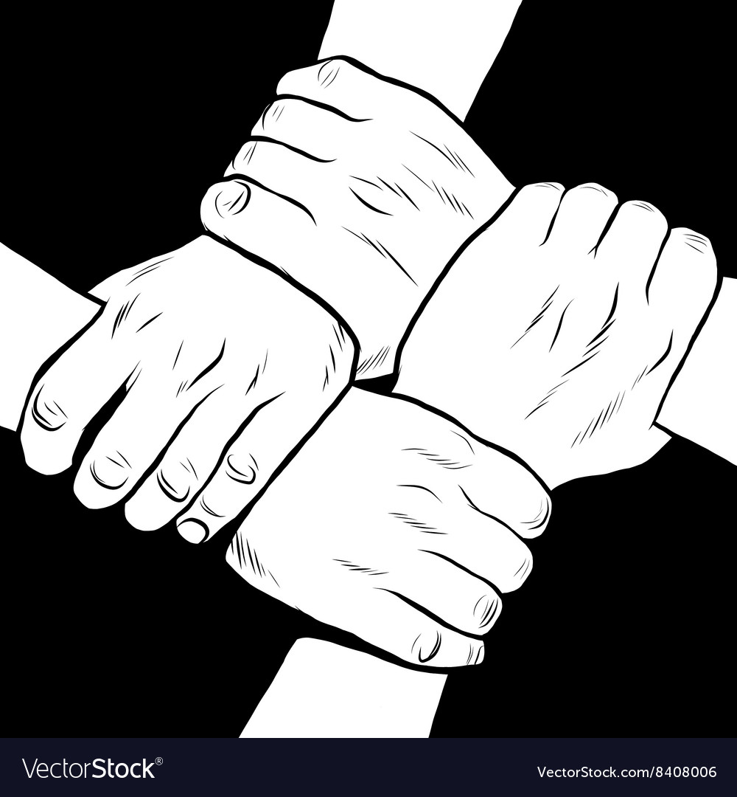

{.header-banner}

*Las Preferencias Sociales ayudan a las personas y a los grupos que ellas conforman.*

---

[Proyecto Original](https://drive.google.com/file/d/1Yw_nSHmWhhVjyFMVC0XJc5nWYdIQ3Jcy/view) 

[Manual del procedimiento UNAJ – Investiga](/media/preferenciasycapitalsocial/Anexo_IV_Reglamento_Técnico-Adm_2017.pdf) 

[Página de producción del proyecto](https://osf.io/8ybze/)

[Publicación final del proyecto](/media/preferenciasycapitalsocial/Combinacion-de-estrategias-experimentales-y-observacionales-para-la-validacion-de-la-medicion-de-preferencias-sociales-Quartulli-D.-Riveiro-M.-2023.pdf) 
