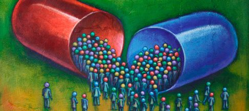

{.header-banner}

### «Uso de medicamentos»
**Programa de Salud Comunitaria de la Universidad Nacional Arturo Jauretche**

- [Ir a información útil para el trabajo de campo](#parte_carga)
- [Ir a información útil para el análisis de los datos](#parte_datos)

---

### Trabajo de campo y carga {#parte_carga}

- [Acceso al sistema de carga](/content/usomedicamentos/sistema-de-carga.html)
- [Diseño de la muestra](https://docs.google.com/document/d/1r-FnD1SekPTPDejn_mElNbn2-ds1bfJttnR37w2i1FA/edit?usp=sharing)
- Mapas para el trabajo de campo
- [Script de R](https://raw.githubusercontent.com/diegoteca/public_files/master/muestra_silberman.R) para el análisis de cluster realizado para la estratificación de la muestra.

---

### Análisis de los datos {#parte_datos}

- [Acceder a extracto de los datos en formato planilla de cálculo (11/03/2020)](https://docs.google.com/spreadsheets/d/1vT1H5JQJRjlwec6BiRq6cfaR0biXsLb_6egHoLPcY7A/edit?usp=sharing)
- Acceder a extracto de bases de datos en formato .SAV para usarse con SPSS o PSPP (11/03/2020):
  - Base 1 – [Hogar y Vivienda](https://drive.google.com/file/d/1WPbjRt3TPMOePLMDbdTypEzVs9r-IXbT/view?usp=sharing)
  - Base 2 – [Personas con alguna enfermedad (con datos del hogar)](https://drive.google.com/file/d/1GdAEAkz6Uf-Ycrdz0U9AfY5EvVOXLRES/view?usp=sharing)
  - Base 3 – [Consumo de medicamentos (con datos del hogar)](https://drive.google.com/file/d/19MVQucbT7X2ADVl5rJC4VJ_nVWkbmbCS/view?usp=sharing)
  - Base 4 – [Autoconsumo (con datos del hogar)](https://drive.google.com/file/d/1CtyhRnoenaVuE0eaQtkSdH-A3tjOvvAh/view?usp=sharing)
- [Sintaxis SPSS](https://drive.google.com/file/d/1L_Qcq711WeBlMByIeMRX2A54iXAsP-JZ/view?usp=sharing) de limpieza (mínima) y pegados de bases.
