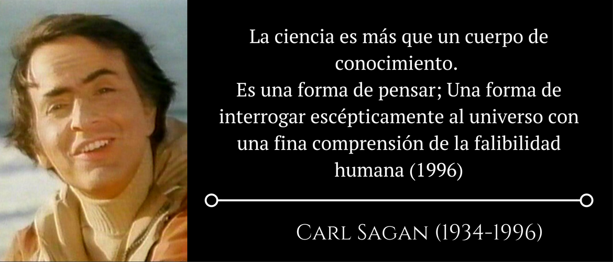

{.header-banner}

Bienvenido al archivo digital de **Diegoteca**.

Este sitio reúne y preserva los contenidos, programas docentes, investigaciones y materiales producidos a lo largo de los años en formato estático, reproducible y abierto.

---

### Secciones principales

- **Investigación**:
  - [Tesis Doctoral](content/root/tesis-doctoral.qmd): *Efectos de origen de clase en la Argentina (1955-2001)*.
  - [Encuesta Nacional de Relaciones Sociales](content/root/enrs.qmd): ENRS.
  - [Nodocentes](content/root/nodocentes.qmd): Condiciones de trabajo y trayectorias.
  - [Muestra Salud UNAJ 2018](content/muestra-unaj/inicio.qmd): Diseño de muestra en Florencio Varela.
  - [Uso de Medicamentos](content/usomedicamentos/uso-de-medicamentos.qmd): Programa Salud Comunitaria.
  - [Encuesta Socioeducativa 2016](content/encuestasocioeducativa2016/bienvenida.qmd): Trabajo Social.
  - [Preferencias Sociales y Capital Social](content/preferenciasycapitalsocial/inicio.qmd): Protocolo experimental y mediciones.

- **Docencia**:
  - [Metodología de la Investigación Cuantitativa UNAJ](content/metodocuanti/inicio.qmd): Programa, cronogramas, unidades 1 a 4, aplicaciones y trabajos prácticos integradores.
  - [Cultura y Sociología del Trabajo UNAJ](content/sociologiadeltrabajo/inicio.qmd): Programa, clases teóricas y lecturas.
